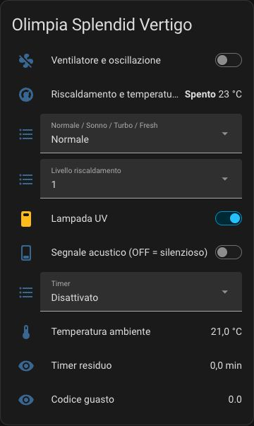

# Olimpia Splendid Vertigo for Home Assistant

Independent custom integration for local control of the OS Home / Tuya 3.3 Vertigo variant. Uses [TinyTuya](https://github.com/jasonacox/tinytuya), without LocalTuya or a cloud connection for normal operation.

**Version 0.1.0 is an initial release.** The parameter map comes from an OS Home device schema and commands previously checked through LocalTuya. This new implementation has automated tests against Home Assistant 2026.10.0 with a simulated transport; it has not yet been installed and physically tested on a Vertigo. Compatibility with other Vertigo variants is unverified.



*Example dashboard using the existing LocalTuya entities. The standalone component exposes the same functions and adds a separate oscillation switch. The image contains only the Vertigo card.*

## Features

- Fan power and nine speed levels.
- Horizontal oscillation, also exposed as a separate switch.
- Normal, Sleep, Turbo and Fresh presets.
- Heater on/off, four heating levels, target and ambient temperature.
- UV lamp and acoustic signal; switch off the acoustic signal for silent operation.
- Timer disabled or 1–8 hours, remaining minutes and raw fault code.
- Manual setup wizard, connection check, address/key reconfiguration and configurable polling.

Heater OFF disables heating while preserving fan power. Fan OFF switches off the whole appliance. Setting a temperature does not turn heating on. Manual fan speed returns the fan preset to Normal. No commands are replayed automatically after reconnecting.

## Requirements

- Home Assistant **2026.10.0 or newer**. Only 2026.10.0 has been tested.
- Vertigo with the parameter map in [docs/parameters.md](docs/parameters.md) and Tuya protocol **3.3**.
- Home Assistant can reach the device on TCP 6668.
- Your device's IP address/hostname, device ID and 16-byte local key.

The component does **not** retrieve a local key automatically. OS Home account linking to the Tuya developer platform may not be available for every OEM account. See [parameter recovery](docs/parameters-recovery.md), including an optional Android emulator method.

## Install with HACS

1. In HACS, open the menu → **Custom repositories**.
2. Add `https://github.com/igorsko/ha_os_vertigo`, category **Integration**.
3. Download **Olimpia Splendid Vertigo** and restart Home Assistant.
4. Disable any existing local integration for this same device and close OS Home before the connection check.
5. Open **Settings → Devices & services → Add integration → Olimpia Splendid Vertigo**.
6. Enter a name, address, device ID and local key. The wizard performs a read-only local status check.

This is a HACS custom repository, not a claim of inclusion in the HACS default catalogue or an official Home Assistant integration.

## Manual installation

Copy only `custom_components/olimpia_vertigo` from this repository into `/config/custom_components/olimpia_vertigo`, restart Home Assistant, then follow steps 4–6 above. Keep the directory name `olimpia_vertigo`; it is the integration domain, independent of the GitHub repository name.

## Installazione e utilizzo in italiano

In HACS aggiungi questo repository come **Integrazione personalizzata**, scaricalo e riavvia Home Assistant. In **Impostazioni → Dispositivi e servizi → Aggiungi integrazione** cerca **Olimpia Splendid Vertigo**. Inserisci i parametri del tuo dispositivo: indirizzo, ID e chiave locale. Il modulo è disponibile in italiano.

Prima della verifica chiudi OS Home e disabilita l'altra integrazione locale dello stesso Vertigo. Il dispositivo potrebbe non gestire più connessioni locali contemporaneamente. Per tornare alla configurazione precedente, disabilita questo componente e riabilita l'integrazione precedente: non è necessario riassociare il dispositivo.

Le entità nuove hanno identificatori propri: la plancia precedente non viene sostituita automaticamente. Puoi aggiungerle dal dispositivo tramite **Aggiungi alla plancia**, oppure adattare [l'esempio YAML](examples/dashboard.yaml) agli ID assegnati nel tuo sistema.

**Silenzioso:** disattiva **Segnale acustico**. **Riscaldamento spento:** spegne il riscaldamento lasciando la ventilazione disponibile. **Ventilatore spento:** spegne l'apparecchio. La temperatura viene inviata come intero da 1 a 30 °C, secondo lo schema rilevato.

## Troubleshooting

- **Cannot connect:** verify the address, firewall and local key; close other clients. Reserve the address in the router's DHCP settings.
- **Key changed:** a new pairing may replace it. Obtain the current key and use the integration's **Reconfigure** menu.
- **Unavailable:** communication has failed or a required parameter is missing. The integration does not invent a device state.
- **Command did not apply:** the UI reflects read-back status rather than an assumed success. Check the mode and device directly.
- **Fault code:** raw bitmap only; meanings of individual flags have not been established.
- **Different model/firmware:** do not assume this parameter map applies. Open an issue with sanitized diagnostics and model details, never a key or account dump.

## Development and validation

```sh
python3.14 -m venv .venv
.venv/bin/python -m pip install -r requirements-test.txt
.venv/bin/python -m pytest -q
.venv/bin/ruff check .
```

Tests cover wire types, all nine speed round trips, heater semantics, read-back state, failure handling, serialized I/O, cancellation, sanitized diagnostics and actual Home Assistant platform loading/unloading and config flows. They do not command real hardware.

The integration uses one serialized local client, executor-based blocking I/O and a shared [Home Assistant update coordinator](https://developers.home-assistant.io/docs/integration_fetching_data/). Polling defaults to 15 seconds and can be changed to 10–120 seconds through **Options**. Credentials remain in Home Assistant's configuration storage and are excluded from integration diagnostics.

## License

MIT. Community project, not affiliated with Olimpia Splendid, Tuya or Home Assistant. TinyTuya is a separately installed MIT-licensed dependency. Product information: [Olimpia Splendid Vertigo](https://www.olimpiasplendid.it/trattamento-aria/purificatori-daria/vertigo).
